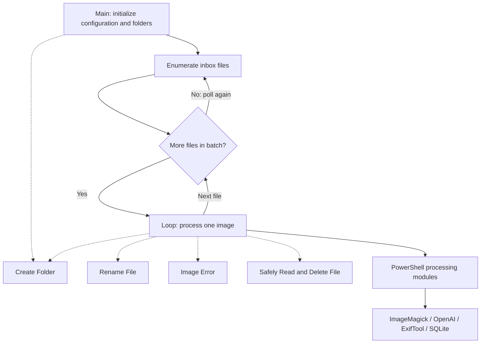
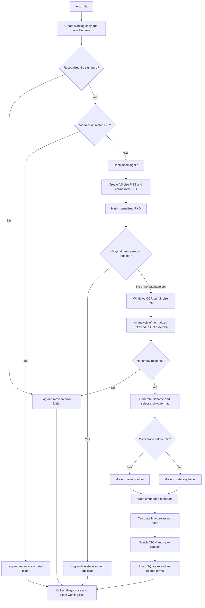
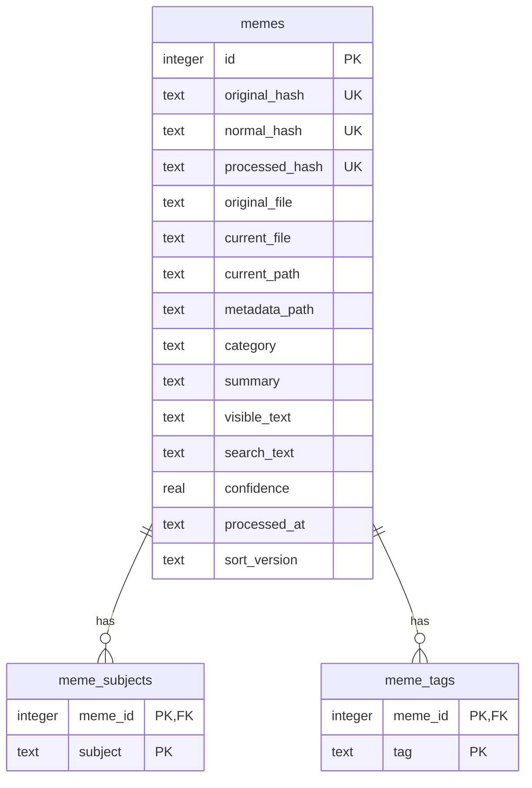

# Meme Organizer

**AI-assisted image classification, metadata enrichment, and searchable archiving with Power Automate Desktop, PowerShell, and SQLite.**

Meme Organizer (internally versioned as `MemeDaemon 1.0`) is a personal automation project that transforms an unstructured collection of images into a categorized, searchable digital archive. I built it to develop practical Power Automate skills and explore how robotic process automation (RPA), artificial intelligence, scripting, and relational databases can work together to solve an information management problem.

Although the dataset is informal, the underlying workflow addresses challenges common to business systems: inconsistent incoming data, duplicate records, manual classification, unstructured information, exception handling, application integration, and data integrity.

## Problem and requirements

Images downloaded from different sources frequently have arbitrary filenames, inconsistent formats, and useful information embedded in the image rather than stored in searchable fields. Duplicate files accumulate over time, and manually reviewing, naming, and filing every image does not scale well.

I defined the following requirements for the automated workflow:

- Accept batches of images with inconsistent filenames and formats.
- Verify file types and distinguish static images from animated or unsupported media.
- Detect previously indexed duplicates before making paid AI requests.
- Extract visible text and generate meaningful categories, summaries, subjects, and search tags.
- Standardize filenames and preserve searchable metadata independently of the image format.
- Maintain a relational index for more flexible queries than a folder hierarchy alone permits.
- Route uncertain classifications to a manual review queue and retain diagnostic information when processing fails.
- Control API costs and support local testing of downstream integrations.

## Results and development testing

| Measure | Observed result |
| --- | --- |
| Batch processing | A development run processed approximately 2,000 images, with only two reported rejections. |
| API cost | A ten-image test using `gpt-5.4-mini` cost approximately $0.01, compared with an earlier observed cost of $0.0048 per image. |
| Searchability | Images can be located through descriptive filenames, category folders, embedded metadata where supported, and structured SQL queries. |
| Exception management | Separate destinations distinguish low-confidence classifications, animated media, and processing errors. |
| Diagnostic coverage | Per-image error reports consolidate information from PAD, PowerShell, OCR, the AI API, ExifTool, and SQLite. |

The batch and cost figures are observations from development rather than formal benchmarks. The rejection count does not establish classification accuracy. API costs vary with model and input characteristics. Manual time savings and classification accuracy have not been formally measured.

## System architecture

Power Automate Desktop (PAD) acts as the workflow orchestrator. PowerShell scripts encapsulate specialized processing logic, while structured JSON and file paths provide interfaces between components. SQLite serves as the persistent search index.

### Power Automate Desktop flow structure

The desktop flow consists of `Main` and five supporting subflows. `Main` centralizes configuration and dispatches incoming files; `Loop` contains the actual per-image processing logic. Four smaller subflows encapsulate recurring file operations and error-handling tasks.



| PAD subflow | Responsibility |
| --- | --- |
| `Main` | Declares workflow version, script names and paths, directory configuration, database location, and executable paths. Creates required folders, enumerates the inbox, and calls `Loop` for each file. |
| `Loop` | Executes the complete image-processing pipeline, including validation, normalization, hashing, duplicate lookup, OCR, AI classification, routing, metadata persistence, and diagnostic cleanup. |
| `Create Folder` | Checks whether a required directory exists before creating it. Used for initialization and category folders. |
| `Rename File` | Centralizes renaming with Windows extended-length path syntax and returns the expected new path. |
| `Image Error` | Appends a timestamped message with the iteration number to the operational log and moves the input to a specified destination. |
| `Safely Read and Delete File` | Reads an existing diagnostic artifact and deletes it after collection, avoiding repeated file-existence checks throughout the main processing logic. |

This separation keeps configuration in one place, gives the per-image workflow a clear execution boundary, and avoids duplicating common file operations across processing branches.

### Image-processing workflow



OCR runs first on the full-size working PNG. The GPT script then classifies the normalized PNG and combines the result with cleaned OCR in a single JSON record. The per-image error-handling region also captures unexpected PAD and script errors.

### Technology stack

| Technology | Responsibility |
| --- | --- |
| Power Automate Desktop | Configuration, workflow execution, branching, Windows OCR, file operations, and exception routing |
| PowerShell | Custom processing rules, REST API integration, data transformations, hashing, SQL generation, and diagnostics |
| Windows OCR | Local extraction of text embedded in images |
| OpenAI Responses API | Visual classification and semantic metadata generation using structured outputs |
| ImageMagick | Image conversion, normalization, resizing, and image-characteristic analysis |
| ExifTool | Embedded metadata removal and enrichment |
| SQLite | Persistent indexing, duplicate lookup, relational queries, and transactional record updates |
| JSON | Structured interfaces and portable per-image metadata records |

## Key implementation decisions

### Separate the working image from the archived image

The workflow first uses `robocopy` to create a working copy in the debug directory, then assigns it a short temporary filename containing the iteration number and a random identifier. File signatures are checked before trusting the original extension. WebM, MP4, and multi-frame GIF inputs are routed away from the static-image pipeline.

The normalization module converts the working copy to PNG when necessary, strips metadata, and creates a resized representation within a 512 × 512 bounding box. These two representations serve different purposes:

- The full-size working PNG is used for Windows OCR to preserve available text detail.
- The smaller normalized PNG is used for AI classification, normalized hashing, and image-characteristic analysis.

The archive image is handled separately. Existing JPEG and PNG files are retained in their formats; other recognized static formats are converted to JPEG or PNG using heuristics based on color count, edge density, transparency, and OCR content. Conversion operates on the original-resolution source rather than the resized AI input.

This design reduces the size of AI inputs without unnecessarily resizing the archived image.

### Separate semantic interpretation from text extraction

The AI model interprets image content, including humor, wordplay, sarcasm, and visual context. The OpenAI Responses API is configured with `gpt-5.4-mini`, low reasoning effort, low image detail, and a strict JSON schema requiring category, summary, subjects, tags, and confidence.

The schema restricts categories to a defined taxonomy, such as Animals, History, Politics, Reaction, ScienceTechnology, and TVMovies. This prevents arbitrary folder names from being generated as classification results.

Windows OCR operates locally. Its output is cleaned by the GPT integration script and attached to the JSON after the API response; the extracted OCR text is not included in the AI prompt. The original filename is sanitized and used only as a weak contextual hint. Separating these sources keeps extracted text distinct from AI-generated descriptions and avoids sending a separate OCR transcript with every request.

The current OCR cleanup deliberately retains only ASCII letters and spaces, with a maximum of 1,800 characters. This favors compatibility with downstream metadata and search operations at the expense of punctuation, numbers, and non-English characters.

### Track identity throughout the processing lifecycle

A file hash changes when its bytes change, even when the visible image appears unchanged. Conversion and metadata updates therefore require separate identity fields rather than a single hash that is assumed to remain valid throughout processing.

| Field | When calculated | Purpose |
| --- | --- | --- |
| `original_hash` | Before normalization | MD5 of incoming file bytes; used for duplicate lookup against the existing database |
| `normal_hash` | After normalization and resizing | MD5 of the normalized PNG; used in filenames and as the SQLite upsert conflict key |
| `processed_hash` | After the archive image has been moved and embedded metadata written | MD5 of the final archived file; appended to the JSON before persistence |

Development testing revealed that visually identical inputs can produce different normalized file hashes. I therefore returned duplicate lookup to the original file hash instead of relying on normalization as a guarantee of visual equivalence.

This is exact-file duplicate detection, not perceptual duplicate detection. It also checks only the database's `original_hash` field; recognizing previously processed or re-encoded versions is an opportunity for further improvement. MD5 is used as a non-security file fingerprint.

### Make information searchable outside the automation

The workflow preserves metadata in four complementary forms:

- **Filenames:** concise terms derived from subjects and visible text, or tags when no usable OCR slug is available.
- **Embedded metadata:** titles, descriptions, keywords, subjects, comments, and acquisition dates where supported by the image format and consuming application.
- **JSON sidecars:** portable records containing classification and processing information, including all three hashes.
- **SQLite:** a relational index for queries across categories, subjects, tags, summaries, and extracted text.

The filename module generates a standardized base name using these patterns:

```text
With usable OCR:     subject-slug_hash_ocr-slug.ext
Without usable OCR:  subject-slug_hash_tag-slug.ext
```

The eight-character segment comes from the normalized hash. Slugs use ASCII letters and numbers, remove common stop words and repeated terms, and have bounded lengths. The complete filename stem is limited to 150 characters to reduce Windows path-length problems.

The database provides structured retrieval while the JSON and embedded metadata retain useful information independently of the automation.

### Build human review into automated decisions

A confidence threshold of `0.65` determines whether an image is moved to its assigned category folder or to `!NeedsReview`. Both paths continue through embedded metadata writing, JSON persistence, and database indexing, preserving the analysis even when manual review is required.

The threshold is an explicit workflow rule based on the model's self-reported confidence, not a calibrated probability of correctness. The current version establishes the review queue but does not implement a separate review-and-correction interface.

### Preserve traceability and isolate failures

The automation distinguishes expected routing events (duplicates, unsupported files, and animated media) from execution errors. Expected events are recorded in a timestamped operational log; PAD and PowerShell errors can trigger a more detailed per-image Markdown report.

Diagnostic reports consolidate available information from multiple components:

- Original, temporary, and final filenames; all available hashes; workflow version; timestamp; and iteration number.
- PAD execution errors and individual PowerShell script errors.
- Raw OCR, cleaned OCR, and sanitized filename hints.
- The AI prompt, full API response, extracted model output, and final JSON returned by the GPT script.
- PowerShell execution traces, ExifTool output, and generated SQLite statements.

The cleanup stage collects temporary diagnostic files through the reusable `Safely Read and Delete File` subflow and removes working images. Detailed reports are retained when errors are detected rather than keeping a complete diagnostic bundle for every successful image.

This makes it possible to investigate which integration or transformation failed instead of relying solely on a generic automation error.

## Data model

The SQLite schema separates the primary image record from its potentially many subjects and tags.



The SQL module initializes the schema if needed, enables foreign keys, and enforces uniqueness on the three hash fields. It generates an upsert using `normal_hash` as the conflict key, then refreshes the associated subject and tag records within the same transaction. Composite primary keys prevent repeated terms within each image's related records.

The database includes a combined `search_text` field for simple keyword searches, while separate subject and tag tables support exact-term filtering and reporting. Indexes support category and term lookups.

For example, a future search interface could retrieve reaction images matching a particular term and meeting the automatic-classification confidence threshold:

```sql
SELECT current_file, current_path, summary, confidence
FROM memes
WHERE category = 'Reaction'
  AND confidence >= 0.65
  AND search_text LIKE '%confused%'
ORDER BY confidence DESC;
```

Alternatively, related records can be queried to identify frequently occurring tags:

```sql
SELECT tag, COUNT(*) AS image_count
FROM meme_tags
GROUP BY tag
ORDER BY image_count DESC, tag;
```

The database transaction groups relational updates, but it does not extend to the filesystem. Recovery from a failure between moving the image, saving its JSON, and updating SQLite is a separate reliability concern.

## Repository contents

### Power Automate Desktop exports

| File | Purpose |
| --- | --- |
| `main.txt` | Main configuration, folder initialization, inbox enumeration, and per-file dispatch |
| `loop.txt` | Complete per-image processing and diagnostic workflow |
| `create_folder.txt` | Reusable conditional folder creation |
| `image_error.txt` | Reusable event logging and file routing |
| `renamefile.txt` | Reusable file renaming and path construction |
| `safey_read_and_delete.txt` | Reusable diagnostic artifact collection and deletion (filename as exported) |

### Active PowerShell modules

| File | Purpose |
| --- | --- |
| `verify_1.0.ps1` | Detect file types from binary signatures |
| `animated_1.0.ps1` | Identify animated GIFs and route WebM/MP4 away from static-image analysis |
| `get_hash_1.0.ps1` | Generate an MD5 file hash |
| `normalize_1.0.ps1` | Convert the working image to PNG, strip metadata, resize a copy, and return its normalized hash |
| `duplicate_1.0.ps1` | Look up an original file hash in SQLite |
| `gpt_1.0.ps1` | Clean OCR and filename hints, call the OpenAI API, enforce structured output, and assemble metadata |
| `filename_1.0.ps1` | Generate a bounded, searchable filename stem |
| `convert_1.0.ps1` | Select and convert the archive format using image-characteristic and OCR heuristics |
| `exiftool_1.0.ps1` | Write embedded metadata to archived images using ExifTool |
| `sidecar_1.0.ps1` | Append the processed file hash to the JSON record |
| `sql_upsert_1.0.ps1` | Initialize the SQLite schema and insert or update image records and related terms |

### Development and experimental modules

| File | Purpose |
| --- | --- |
| `gpt_dummy_1.0.ps1` | Earlier local test harness that simulates an AI response without an API request |
| `ocr_1.0.ps1` | Standalone OCR cleanup; equivalent cleanup is now performed inside the active GPT script |
| `optimize_1.0.ps1` | Experimental OCR preprocessing using grayscale, contrast adjustment, despeckling, and sharpening |
| `protect_1.0.ps1` | Experimental Windows file protection through access control rules |

These four modules are retained as development artifacts and are not invoked by the current PAD flow. The dummy script predates the current three-hash JSON contract and requires adaptation before it can substitute for the live GPT module.

## Environment and execution

The project is designed for Windows with the following dependencies:

- Power Automate Desktop and Windows OCR (English language support).
- PowerShell and the Windows `robocopy` utility.
- ImageMagick, accessible through the `magick` command.
- ExifTool and the SQLite command-line executable.
- An OpenAI API key stored in the `OPENAI_API_KEY` Windows user or machine environment variable, plus internet access for live classification.

The default paths in `Main` are `C:\MemeOrganizer` for the PowerShell scripts, `C:\sqlite\sqlite3.exe` for SQLite, and `C:\exiftool\exiftool.exe` for ExifTool. The data directory is configured separately:

```text
C:\img\
├── !Sort\               Incoming files
├── !Processed\          Categorized images
├── !NeedsReview\        Low-confidence classifications
├── !Animated\           Animated GIFs and video files
├── !Error\              Failed or invalid inputs
├── !Metadata\           JSON records
├── !Debug\              Logs and temporary diagnostic artifacts
└── meme_index.sqlite    Searchable database
```

### Running the workflow

1. Install the dependencies and configure the API key outside the source code.
2. Recreate `Main` and the five supporting PAD subflows using the supplied text exports, preserving their input and output variables and call bindings.
3. Configure the local paths in `Main` and ensure that the data root exists.
4. Place a small batch of disposable test images in the inbox and start `Main`.
5. Inspect the resulting files, JSON metadata, SQLite records, and any review or error outputs.
6. Stop the desktop flow when the batch is complete.

**Repository status:** This is a development portfolio snapshot, not a packaged installer or a production-ready unattended service. The current exports describe the active 1.0 pipeline. The main flow continuously polls the inbox; it is best used for supervised processing because indefinite execution can accumulate PAD run history.

Use copies of source images when testing. The automation intentionally deletes indexed duplicates, replaces some converted files, rewrites existing embedded metadata, and permits overwrites at certain destinations. Do not run it against the only copy of an archive. The experimental protection script is not required and applies a broad deny rule for write and delete permissions.

Images are sent to the OpenAI API for classification. The workflow is designed for a personal image collection, not confidential business data.

## Lessons learned and next steps

The project evolved from a basic image classifier into an integrated information management pipeline. Many of the design changes came from investigating observed failures rather than adding features in isolation: noisy OCR, incompatible character encodings, invalid or empty AI responses, inconsistent metadata support, long filenames, and file hashes changing after metadata updates.

The next version offers opportunities to improve several areas:

- **Execution lifecycle:** replace unrestricted polling with bounded or event-driven execution and manage log retention for unattended operation.
- **Duplicate detection:** recognize re-encoded and previously processed images, investigate perceptual hashes, and make duplicate disposal recoverable.
- **OCR quality:** evaluate the experimental preprocessing module against baseline OCR using a repeatable test set before integrating it into the active flow.
- **Reliability:** validate external command results, improve recovery from partially completed file and database operations, and update the local test harness to match the current data contract.
- **Quality measurement:** establish a labeled regression set to evaluate classification accuracy, review thresholds, OCR quality, throughput, and cost per processed image.
- **Search and review:** build a dedicated interface for querying the existing database and correcting low-confidence classifications.

## Relevance to business analysis and process automation

This project demonstrates my approach to translating a loosely defined operational problem into a structured, maintainable workflow.

| Competency | Application in this project |
| --- | --- |
| Requirements analysis | Identified search, classification, integrity, cost, and exception-handling needs and translated them into functional requirements. |
| Business process design | Defined the normal processing path, decision rules, exception routes, and manual review boundary. |
| Systems integration | Connected desktop automation, local command-line utilities, a REST API, and a relational database through structured interfaces. |
| Data management | Designed a classification taxonomy, metadata contract, identifier lifecycle, relational schema, and searchable records. |
| Root cause analysis | Used cross-component diagnostics to isolate issues involving OCR, API responses, metadata compatibility, filename constraints, and duplicate detection. |
| Continuous improvement | Used observed processing results and cost measurements to refine the workflow while identifying remaining reliability and quality-measurement needs. |

The same principles apply to business workflows such as document intake, inventory exception triage, transaction reconciliation, and master-data enrichment, where automation must balance efficiency with data quality, operational controls, and maintainability.
